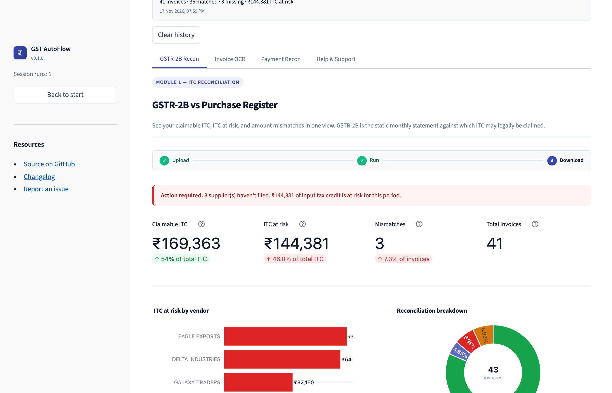
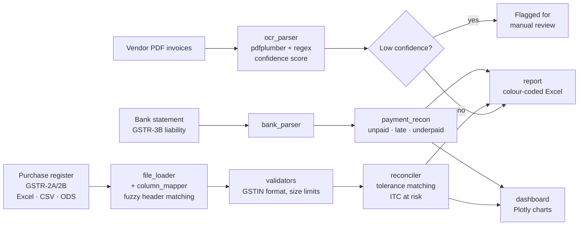

# GST AutoFlow

[](https://github.com/Sudheer-029/gst-autoflow/actions/workflows/ci.yml)

[](LICENSE)

**Recover your blocked ITC in minutes, not hours.**

**[▶ Try the live demo](https://gst-autoflow.streamlit.app/)**: sample files are in the app's Help & Support tab, so no real data is needed.

GST AutoFlow automates the three reconciliation tasks Indian SMBs waste the most time on every month: matching GSTR-2A/2B against your purchase register, extracting structured data from vendor PDF invoices, and reconciling bank payments against GSTR-3B liability.

No signup. No CA fees. Uploaded files are never saved.



*Sample data: 41 invoices reconciled, 3 suppliers who haven't filed, ₹144,381 of input tax credit flagged at risk.*

## What it does

| Module | What you get |
| --- | --- |
| **GSTR-2A / 2B Reconciliation** | See exactly which suppliers haven't filed, how much ITC is at risk, and where amounts mismatch — in one colour-coded Excel report. |
| **Invoice OCR Parser** | Drop in vendor PDFs. Get GSTIN, invoice number, date, and tax amounts extracted automatically, with low-confidence rows flagged for manual review. |
| **Payment Reconciliation** | Match your bank statement against GSTR-3B liability. Spot unpaid, late, and underpaid entries before the department does. |

## How it works



Design choices:

- **Never guess silently.** OCR rows below the confidence threshold are flagged for review instead of being passed through.
- **Tolerant matching.** Differences up to ₹10 between books and GSTR-2A/2B are treated as rounding; anything beyond tolerance is a mismatch with the exact difference shown.
- **Messy input is expected.** Vendor and accounting-software exports use different column names, so headers are mapped to a standard schema (exact → alias → fuzzy match) before validation.

## Quick start

```bash
pip install -r requirements.txt
streamlit run app.py
```

Or with Docker:

```bash
docker build -t gst-autoflow .
docker run -p 8501:8501 gst-autoflow
```

Open the URL Streamlit prints (default `http://localhost:8501`). Sample files for every module are in `sample_data/` — use the **Download template** buttons inside each module to get them directly.

## Privacy

- Uploaded files are processed in memory and never written to disk
- Results (reconciled rows and the Excel report) are saved on the server so a page refresh doesn't lose them, and are deleted automatically after 48 hours
- There is no database
- No cookies that identify you
- Optional anonymous usage telemetry (disabled by default; see below)

> **Session note:** Results are tied to the session ID in your URL (`?s=...`). Anyone with that exact URL can open your results until they expire, so don't share it. Download your Excel report; after 48 hours the server copy is gone.

### Optional telemetry

The app can send anonymous usage events (which module ran, how many invoices — never file content). Disabled unless explicitly enabled:

```bash
export GST_AUTOFLOW_TELEMETRY=1
export GST_AUTOFLOW_TELEMETRY_URL=https://your-collector.example/events
```

## Project layout

```
gst-autoflow/
├── app.py                    # Streamlit entry point and UI
├── gst_autoflow/             # Reusable reconciliation library
│   ├── reconciler.py         # GSTR-2A vs Purchase Register
│   ├── ocr_parser.py         # PDF invoice extraction
│   ├── payment_recon.py      # Bank vs GSTR-3B liability
│   ├── bank_parser.py        # Bank statement parsing
│   ├── column_mapper.py      # Fuzzy column-name mapping
│   ├── dashboard.py          # Plotly chart helpers
│   ├── report.py             # Excel report writers
│   ├── validators.py         # Input validation + size limits
│   ├── telemetry.py          # Anonymous, opt-in usage events
│   └── ocr_patterns.py       # Field-extraction regexes
├── tests/                    # pytest suite (reconciler, OCR, payment recon)
├── docs/                     # README screenshots
├── sample_data/              # Anonymised test data + invoice PDFs
├── .streamlit/
│   ├── config.toml           # Theme + server settings
│   └── styles.css            # App stylesheet
├── Dockerfile
├── .github/workflows/ci.yml  # Tests on Python 3.11 + 3.12, Docker build
├── requirements.txt
├── LICENSE
└── README.md
```

## Tech stack

- **Streamlit** — UI framework
- **pandas** — data processing
- **pdfplumber** + **Pillow** — PDF text extraction
- **plotly** — interactive charts
- **openpyxl** — Excel I/O

## Running Tests

```bash
pip install -r requirements.txt -r requirements-dev.txt
pytest -q
```

18 tests cover the three core engines:

- **Reconciler:** tolerance matching, GSTIN normalisation, ITC-at-risk calculation, claimable-ITC boundary conditions
- **OCR parser:** field extraction from generated invoice PDFs, partial-extraction status for review, blank-PDF handling without crashes
- **Payment reconciliation:** on-time, late, unpaid, underpaid and overpaid detection

CI runs the suite on Python 3.11 and 3.12 and builds the Docker image on every push and pull request.

## Multi-tester Deployment Note

Session data is stored in `~/.gst_autoflow/sessions/` on the host running Streamlit. If multiple internal testers access the same deployed server, each tester gets a unique session ID (stored in the URL as `?s=<id>`) — sessions do not cross-contaminate unless someone deliberately shares a URL.

If you are running a shared testing instance, set the `GST_SESSION_DIR` environment variable to a per-user path (e.g. `/home/<user>/.gst_autoflow/sessions`) or deploy separate instances per tester.

## Contributing

Issues and PRs welcome. If you run a small business in India and have a reconciliation pain point this app doesn't solve, open an issue with a description and (if possible) a sanitised sample file.

## License

[MIT](LICENSE) © 2026 Sudheer Bishnoi

Built by [Sudheer Bishnoi](https://sudheer-029.github.io) · [LinkedIn](https://linkedin.com/in/sudheer-bishnoi-2a7330207)
